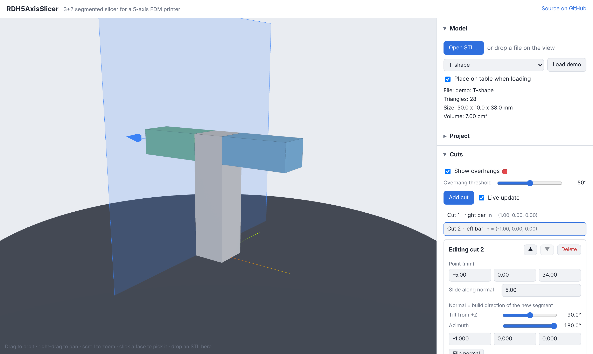
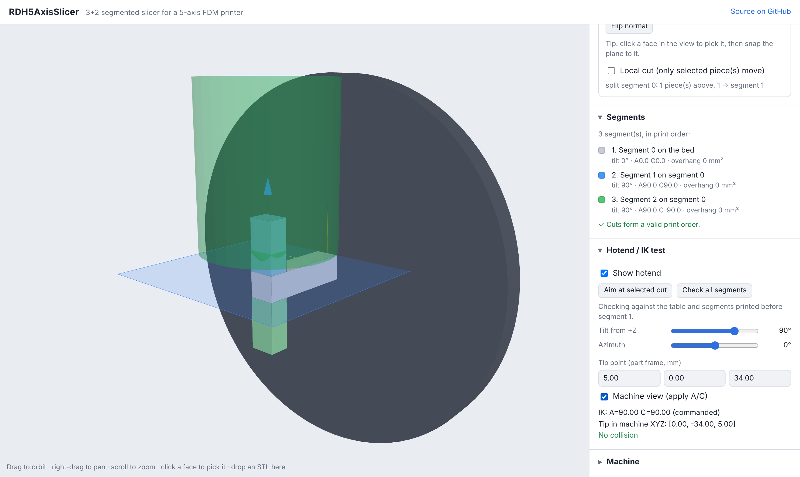

# RDH5AxisSlicer

**A "3+2" segmented slicer for a DIY 5-axis FDM printer, running in your browser.**

### ▶ [Open the slicer](https://heberligr.github.io/RDH5AxisSlicer/)

Nothing to install: the link opens the app. It starts with an example already
cut into segments.

| Overhangs flagged in red | Cut into segments | Machine view of segment 1 |
|---|---|---|
|  |  |  |

**Status:** milestones 1–2 (math core and manual segment editor). Automatic
segmentation, slicing and G-code output are next.

## The idea

A normal printer builds everything straight up, so anything sticking out
sideways (an overhang) needs support material. This printer has a tilting
(A) and rotating (C) table, so the part can be **cut into chunks (segments)**,
each printed with flat layers in its own direction:

1. Load a part. Faces that would need support are shown **red**.
2. Add **cuts**. Each cut is a plane, and its normal is the build direction of
   the new segment on that side.
3. The app splits the part into watertight segments and works out which one
   rests on which, and therefore the **print order**. It also computes the
   **A/C table angles** for each segment and checks that the **hotend won't
   hit** anything.
4. While printing a segment the rotary axes never move. They only turn
   between segments.

## Using it

| What | How |
|---|---|
| Open your own part | **Open STL…**, or drag an `.stl` onto the 3D view |
| Try a built-in part | **Demo part** → Cube / Cube with arm / T-shape → **Load demo** |
| Add a cut | **Add cut**, then set the point and normal (sliders or numbers) |
| Snap a cut to a face | Click a face in the 3D view, then **Normal ← face** / **Point ← picked** |
| Local cut | Tick **Local cut** to move only the piece(s) you choose |
| Reorder / delete | ▲ ▼ **Delete** on the selected cut (order matters, see below) |
| Save your work | **Project → Save project** downloads one `.json` file (your STL is stored inside it) |
| Reopen | **Project → Open project…**, or drag the `.json` onto the view |
| Check a segment's angles | **Hotend / IK test → Aim at selected cut**, then tick **Machine view** |
| Use your machine's numbers | **Machine → Load machine.yaml…** (or edit `config/machine.yaml` in the repo) |

### How cuts behave

- A cut only splits the segment that **contains its point**. A plane that
  passes through other segments leaves them alone.
- **Normal cut:** everything on the normal's side becomes the new segment.
- **Local cut:** that side can be several separate pieces (e.g. two posts).
  Only the ticked piece(s) move, and the rest stay with the segment that was
  cut.
- Cuts are applied in list order, so **▲ ▼ can change the result**.
- **Print order** comes from the geometry: each segment's flat base face rests
  on some other segment, and that one prints first.
- The Segments panel warns about cuts that are skipped, pieces printing in
  mid-air, segments that depend on each other in a loop, and directions
  beyond the A-axis limits.

**Overhang rule:** with build direction `d`, a face is an overhang when its
normal is within `90° − threshold` of `−d`. The default threshold is 50°, so
faces leaning more than 50° from vertical count. Faces sitting on a segment's
own base never count.

## Your machine: `config/machine.yaml`

Every value marked **FILL IN** is a placeholder until the hardware exists.
Edit the file in the repo (GitHub's pencil icon works) and the site updates
within a minute or two. To try other numbers without changing the repo, use
**Machine → Load machine.yaml…**.

| Key | What it is |
|---|---|
| `kinematics.pivot` | Machine XYZ where the A and C axes cross |
| `kinematics.*.sign` | `1` if a positive G-code angle turns the table by the right-hand rule, `-1` otherwise |
| `kinematics.*.min_deg/max_deg` | Rotary travel limits, in G-code (commanded) degrees |
| `table.*` | Rotary table size, and Z of its top surface at A = 0 |
| `hotend.*` | Collision envelope: a cone at the tip plus a cylinder for the heater block / fan |

## How the math works

**Kinematics.** The part sits on the C table, and the C table sits on the A
trunnion, so a part point `p` ends up at

```
machine = R_A(a) · R_C(c) · (p − pivot) + pivot
```

For a segment with build direction `d`, the inverse kinematics (IK) finds `a`
and `c` with `R_A R_C d = +Z`, so that segment's layers are horizontal under
the nozzle:

1. Turn C so `d` lies in the YZ plane: `c = 90° − atan2(dy, dx)`.
2. Tilt A by the angle between `d` and vertical: `a = atan2(√(dx²+dy²), dz)`.

There's always a mirror solution (`a → −a`, `c → c − 180°`). The code keeps
whichever is inside the limits with the smaller C move.

**Collision check.** Obstacles (the table, and segments already printed) are
turned into points spread ~1 mm apart over their surfaces. For a nozzle
position, those points are rotated into the tool's frame and tested against
the cone + cylinder. The shape is grown slightly so nothing slips between the
points, so the check errs on the safe side.

**Cutting** uses [manifold-3d](https://github.com/elalish/manifold), compiled
to WebAssembly. It keeps every segment a closed, watertight solid.

## Code map

```
index.html, style.css     the page (GitHub Pages serves these directly; no build step)
config/machine.yaml       your machine
examples/                 saved example projects
src/core/                 all the logic - plain JavaScript, no browser needed
  vec.js, transforms.js   vectors, rotations (direction -> +Z and back)
  config.js               machine.yaml -> validated object, clear errors
  kinematics.js           A/C inverse kinematics, part <-> machine coordinates
  collision.js            hotend cone + cylinder, sampled-surface collision check
  mesh.js, meshIO.js      triangle mesh, STL read/write, placing on the table
  geometry.js             plane cuts and unions (manifold-3d), point-in-mesh, distances
  overhang.js             which faces are overhangs
  segments.js             cuts -> segments, local cuts, print order, warnings
  project.js              save/load projects as JSON
  demoModels.js           cube, cube with arm, T-shape
src/ui/
  viewer.js               the 3D view (three.js)
  app.js                  the side panel and app state
tests/                    unit tests (Node) + tests/e2e browser test
```

## For development (optional)

The app itself needs nothing installed. To run the tests, install
[Node.js](https://nodejs.org) 20 or newer, then:

```bash
npm install
```

```bash
npm test
```

`npm run serve` serves the app at http://localhost:8123 so you can try
changes before pushing. `npm run test:e2e` drives the real page in a headless
browser (needs Playwright with Chromium). `npm run docs:screenshots`
regenerates the images above.

Libraries (three.js, manifold-3d, js-yaml) load from the jsDelivr CDN at
exact pinned versions, set in the `importmap` in `index.html`. The test setup
in `package.json` pins the same versions.
