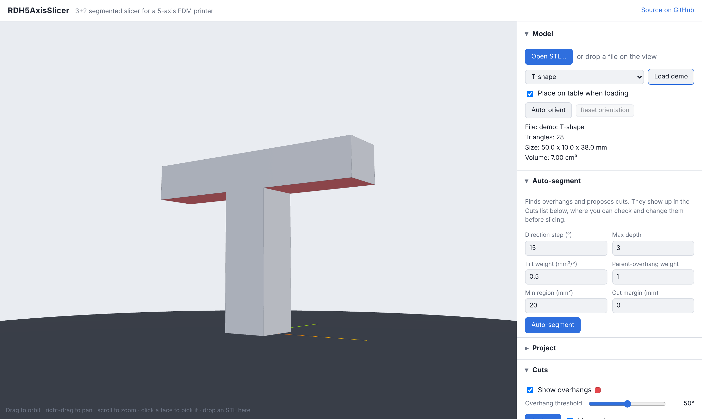
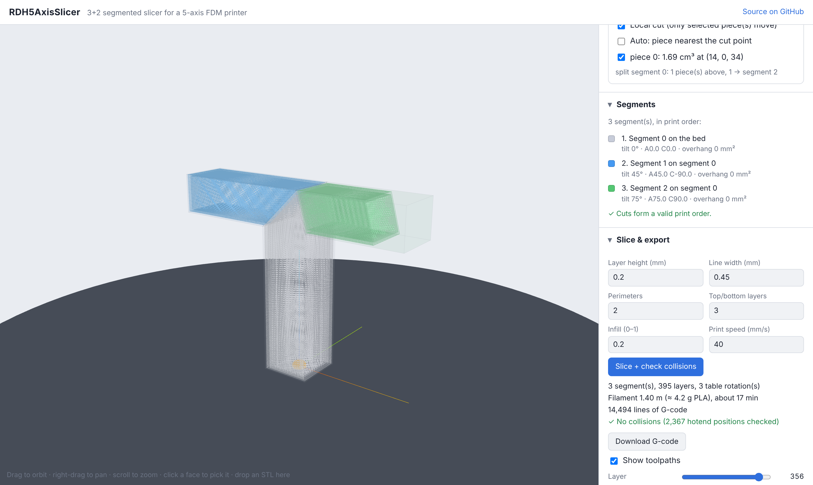

# RDH5AxisSlicer

**A "3+2" segmented slicer for a DIY 5-axis FDM printer, running in your browser.**

### ▶ [Open the slicer](https://heberligr.github.io/RDH5AxisSlicer/)

Nothing to install: the link opens the app. It starts with an example already
cut into segments.

| 1. Overhangs flagged | 2. Auto-segmented | 3. Sliced | 4. Machine animation |
|---|---|---|---|
|  |  |  |  |

## The idea

A normal printer builds everything straight up, so anything sticking out
sideways (an overhang) needs support material. This printer has a tilting (A)
and rotating (C) table, so the part can be **cut into chunks (segments)**, each
printed with flat layers in its own direction:

1. **Load** a part. Faces that would need support are shown in red.
2. **Auto-segment** proposes cut planes. Each cut's normal is the build
   direction of the new segment above it. You can edit, add or delete cuts.
3. **Slice.** Each segment is turned so its direction points up, sliced into
   flat layers, and mapped back.
4. **Check & export.** One G-code file. The table only turns *between*
   segments; while printing, every move is plain X Y Z E. The hotend is
   checked against everything already printed.

## A first print, step by step

> The machine numbers in `config/machine.yaml` are placeholders until the
> hardware is built. Do steps 1–2 before printing anything real.

1. **Describe the machine.** Fill in every `FILL IN` value in
   `config/machine.yaml` (see below). Edit it on GitHub with the pencil icon,
   and the site updates within a couple of minutes. To try values without
   changing the repo, use **Machine → Load machine.yaml…** in the app.
2. **Calibrate the pivot** (next section). This is the single most important
   number.
3. **Open the part:** **Open STL…** or drag it onto the view.
4. **Orientation:** click **Auto-orient**. It tries every big flat face down
   (plus 64 other directions) and keeps the one with the least overhang. If you
   prefer the original, click **Reset orientation**.
5. **Auto-segment.** Look at the result. Each coloured chunk is a segment, the
   Segments panel lists the print order and A/C angles, and the **Decision
   log** explains every choice. Any overhang it couldn't fix is listed in red
   with "needs supports or manual cut".
6. **Fix by hand if needed:** select a cut and change its point/normal, or
   click a face and use **Normal ← face** / **Point ← picked**. Use **Local
   cut** when only one of several pieces should move. The Segments panel must
   say **✓ Cuts form a valid print order** before you can slice.
7. **Slice + check collisions.** Read the summary. Any collision is listed
   with a **Show** button that jumps the layer slider there. Drag the
   **Layer** slider through the print, then press **▶ Play machine animation**
   to watch the table turn between segments.
8. **Save project** (keeps your cuts and settings) and **Download G-code**.
9. **First real test:** print `examples/cube_with_arm.json` in the air
   (no filament, Z raised) and watch that the table turns the way the
   animation shows. Then print it for real.

## Calibrating the pivot point

The pivot is where the A and C axes cross, in machine coordinates. Every
tilted segment is placed relative to it, so an error of 1 mm here puts tilted
segments 1 mm off.

1. **Find the C axis centre (X, Y).** Home, then put a sharp pointer (or the
   nozzle) on a mark near the table centre. Rotate C by 180°. If the mark
   moved, the centre is halfway between the two positions. Repeat until the
   mark doesn't move. The machine X, Y now equals `pivot[0]`, `pivot[1]`.
2. **Find the A axis height (Z).** Clamp a block to the table and touch its
   flat top with the nozzle at A = 0, then note the Z reading, *z0*. Tilt to
   A = 90°. The top face is now a vertical wall, and its distance from the
   pivot hasn't changed. Touch the wall from the side and read its Y
   position, *y1*. Then `pivot_z = z0 − |y1 − pivot_y|`, using `pivot_y` from
   step 1. Measuring again at A = −90° and averaging cancels small errors.
3. **Check:** in the app, **Hotend / IK test** → set a tip point, tick
   **Machine view**, and compare the shown "Tip in machine XYZ" with what the
   machine reads when you jog to the same physical spot at that A/C.
4. **Signs:** jog A positive. If the table top turns toward −Y (right-hand
   rule about +X), `a_axis.sign: 1`, otherwise `-1`. Same for C: positive =
   counter-clockwise seen from above means `sign: 1`.

## Your machine: `config/machine.yaml`

| Key | What it is |
|---|---|
| `firmware` | marlin / reprapfirmware / klipper. Output is plain X Y Z A C joint moves (no TCP mode) |
| `kinematics.pivot` | Machine XYZ where the A and C axes cross |
| `kinematics.*.sign` | `1` if a positive G-code angle turns the table by the right-hand rule, `-1` otherwise |
| `kinematics.*.min_deg/max_deg` | Rotary travel limits, in G-code degrees (C can be `continuous`) |
| `limits` | X/Y/Z travel. Every G-code point is checked; anything outside stops export with a clear error |
| `table.*` | Rotary table size, and Z of its top at A = 0 (it's an obstacle in collision checks) |
| `hotend.*` | Collision envelope: a cone at the tip plus a cylinder for the heater block / fan. Make it a bit bigger than reality |
| `motion.*` | Safe retract distance and safe Z for transitions, feedrates, retraction |
| `start_gcode` / `end_gcode` | Copied into the file verbatim (homing, heating, prime line at A0 C0) |

## Tuning auto-segmentation (`config/settings.yaml`, or the panel)

For every overhang region, the auto-segmenter tries build directions spaced
`candidate_step_deg` apart over the hemisphere that the A axis can reach. For
each direction it puts a cut plane just under the region, makes a **local**
cut (only the piece holding the overhang moves), and scores it:

```
score = overhang left in the new segment            (mm²)
      + weight_parent_overhang × new overhang created in the parent
      + weight_tilt × tilt angle (degrees)
```

It keeps the lowest score whose first layer the hotend can reach without
hitting anything, but only if it beats leaving the region alone
(score < region area). It then repeats for new segments, up to `max_depth`.

| Setting | Raise it to… | Lower it to… |
|---|---|---|
| `overhang.threshold_deg` (50) | allow steeper overhangs (fewer cuts) | be stricter (more cuts) |
| `overhang.min_region_area` (20 mm²) | ignore small overhangs | fix tiny ones too |
| `auto_segment.weight_tilt` (0.5) | prefer gentle tilts, and leave small overhangs alone | allow steep tilts more readily |
| `auto_segment.weight_parent_overhang` (1) | avoid cuts that create overhangs elsewhere | — |
| `auto_segment.candidate_step_deg` (15) | search faster | search finer (slower) |
| `auto_segment.max_depth` (3) | allow cuts on cuts | keep segment trees shallow |
| `auto_segment.cut_margin` (0 mm) | leave some parent under the new segment | cut exactly at the overhang |

A region of *A* mm² is only worth a cut if `weight_tilt × tilt < A`. With the
defaults, a 45° cut costs 22.5, so overhangs smaller than that stay as they
are. Every decision is in the **Decision log**.

## How the math works

**Kinematics.** The part sits on the C table, and the C table sits on the A
trunnion, so a part point `p` ends up at
`machine = R_A(a) · R_C(c) · (p − pivot) + pivot`. For a build direction `d`,
the inverse kinematics finds `c = 90° − atan2(dy, dx)` and
`a = atan2(√(dx²+dy²), dz)`, so that `R_A R_C d = +Z`. The mirror solution
(`−a`, `c − 180°`) is used when it fits the limits better or saves C travel.

**Slicing.** Each segment is rotated with exactly that table rotation, so the
slicer's coordinates are the machine's, minus the pivot shift. There's no
unknown "the slicer moved my part" offset. Layers come from manifold's
`slice()`, perimeters are insets of the outline, and infill is straight lines,
solid within `top_bottom_layers` of any top or bottom.

**G-code.** Relative extrusion (M83). Each transition does: retract → back
off along the tool axis → safe Z → `G0 A… C…` → above the next start → down
→ unretract.

**Collision check.** Obstacles (the table, and segments already printed) are
sampled into points ~1 mm apart. The hotend (cone + cylinder, grown slightly
so nothing slips between points) is tested at several points on *every*
layer, while the table turns (nothing may rise to safe Z), and on the way
down to each segment.

## Code map

```
index.html, style.css     the page (GitHub Pages serves it as-is; no build step)
config/machine.yaml       your machine
config/settings.yaml      default slicer settings
examples/                 projects made by Auto-segment (tools/make-examples.mjs)
src/core/                 all the logic - plain JavaScript, no browser needed
  vec.js, transforms.js   vectors, rotations
  config.js, settings.js  YAML -> validated objects with clear errors
  kinematics.js           A/C inverse kinematics, part <-> machine coordinates
  collision.js            hotend cone + cylinder, sampled-surface collision test
  mesh.js, meshIO.js      triangle mesh, STL read/write, placing on the table
  geometry.js             plane cuts and unions (manifold-3d), point-in-mesh
  overhang.js             overhang faces and connected overhang regions
  orientation.js          Auto-orient
  segments.js             cuts -> segments, local cuts, print order, warnings
  autoSegment.js          Auto-segment (scored search + decision log)
  slicer.js               per-segment planar slicing (walls, solid, infill)
  gcode.js                machine G-code, transitions, limit checks
  checks.js               full collision check before export
  project.js              save/load projects (.json, STL embedded)
  demoModels.js           cube, cube with arm, T-shape
src/ui/
  viewer.js               the 3D view (three.js)
  app.js                  model, cut editor, segments, hotend test
  pipeline.js             auto-orient/segment, slice, preview, animation
tests/                    unit + pipeline tests (Node); tests/e2e drives the real page
```

## For development (optional)

The app needs nothing installed. To run the tests, install
[Node.js](https://nodejs.org) 20+ and run:

```bash
npm install
```

```bash
npm test
```

- `npm run serve` serves the app at http://localhost:8123.
- `npm run test:e2e` drives the page in headless Chromium (needs Playwright).
- `npm run docs:screenshots` regenerates the images above.
- `node tools/make-examples.mjs` regenerates the example projects.

Libraries (three.js, manifold-3d, js-yaml) load from jsDelivr at exact pinned
versions, set in the `importmap` in `index.html`. `package.json` pins the
same versions for tests.

## Limitations

- The slicer is deliberately simple: rectilinear infill, no seams, no bridges,
  no supports. Regions the auto-segmenter can't fix are reported, not
  supported.
- The collision check is conservative and uses a simple hotend shape. It does
  not model the gantry or frame.
- The machine geometry is placeholders until the printer exists.
